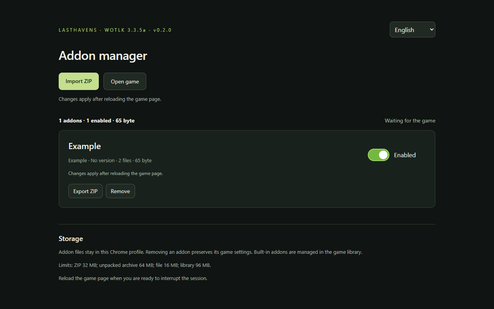

# Lasthavens Addon Manager

[English](../README.md) · [Українська](README.uk.md) · [Русский](README.ru.md) · [Español](README.es.md) · [Français](README.fr.md) · [Português](README.pt-BR.md)

Gestor local de addons para Lasthavens 3.3.5a. Importación ZIP, activación, desactivación, actualización mediante nueva importación, exportación y eliminación. Los cambios requieren recargar el juego.

## Instalación en Chrome

1. Abre [Releases](https://github.com/Jamba777/lasthavens-addon-manager/releases) y descarga `lasthavens-addon-manager-<version>.zip` en **Assets**.
2. Extrae el ZIP en una carpeta que conservarás en tu equipo.
3. Abre `chrome://extensions` en Chrome.
4. **Activa el Modo de desarrollador (Developer mode) en la esquina superior derecha.**
5. Haz clic en **Cargar descomprimida (Load unpacked)** y selecciona la carpeta que contiene `manifest.json`.
6. Abre **Lasthavens Addon Manager** desde el menú de extensiones de Chrome. Puedes fijar su icono.

> Si descargaste **Source code (zip)**, extrae el archivo y selecciona la subcarpeta `extension/`.

## Añadir addons

1. Descarga un addon para **WoW 3.3.5a**.
2. Abre el gestor e importa el ZIP del addon.
3. Activa el addon con el interruptor.
4. **Recarga la página del juego** para aplicar los cambios.

Para actualizar un addon, importa su nuevo ZIP. Se conserva su estado de activación. Desactivar, actualizar o eliminar un addon también requiere recargar la página del juego.

## Actualizar la extensión

Extrae la nueva versión en la misma carpeta de instalación. Abre `chrome://extensions` y pulsa el botón de recarga en la tarjeta de la extensión. Vuelve a abrir el gestor y recarga el juego. Las extensiones descomprimidas no se actualizan automáticamente.

## Almacenamiento y compatibilidad

Los archivos permanecen en el perfil actual de Chrome. La eliminación conserva los ajustes del juego. No se pueden reemplazar carpetas integradas. La compatibilidad de cada addon debe comprobarse en el juego.

| Límite                | Máximo |
| --------------------- | -----: |
| Archivo ZIP           |  32 MB |
| Archivo descomprimido |  64 MB |
| Archivo individual    |  16 MB |
| Biblioteca de addons  |  96 MB |

**Versión experimental:** las comprobaciones locales automatizadas pasan; la compatibilidad completa de la extensión instalada con el cliente actual y los addons de terceros todavía se está verificando. [Estado de validación](VALIDATION.md).

## Desarrollo y licencia

[Desarrollo, pruebas y publicación](DEVELOPMENT.md). La extensión utiliza la [licencia MIT](../LICENSE). Los addons de terceros conservan sus propias licencias y no están incluidos.
